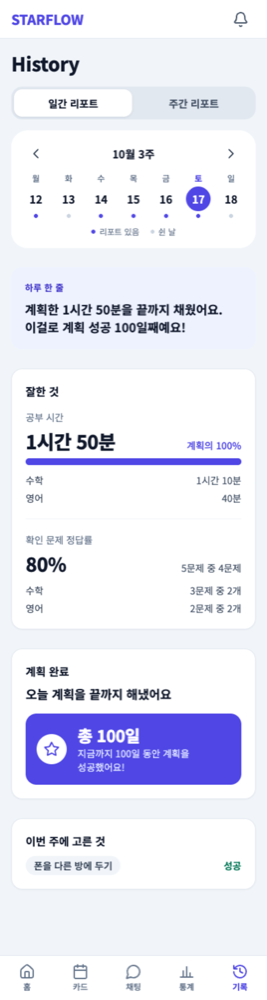
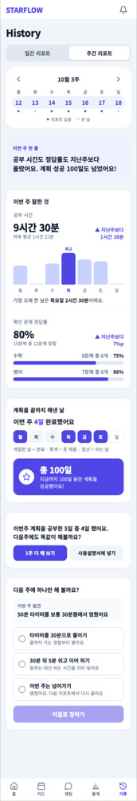
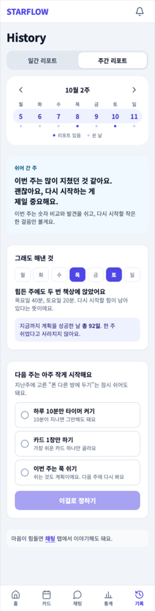
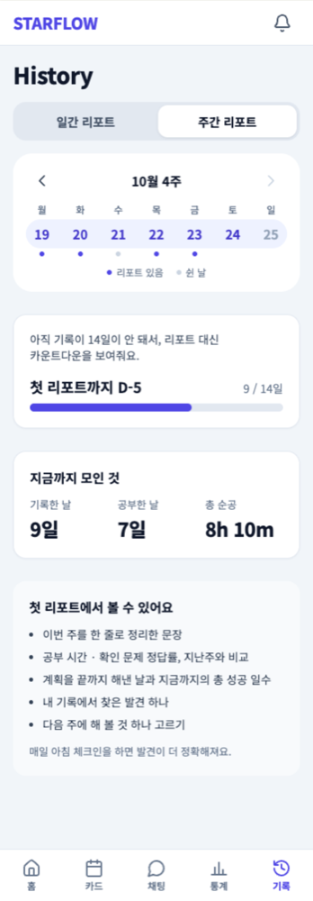
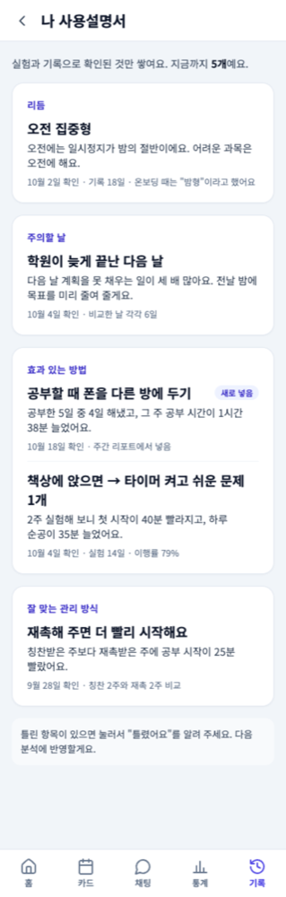

# 화면 시안 (기획서 v2 + 2026-10-10 피드백 반영)

기획서 v2(2026-10-05)를 바탕으로 그린 **화면 시안**입니다. 피그마 대신 이 폴더의 그림을 보고 화면을 만듭니다.

> **2026-10-10 에 바뀐 것** — 피드백 반영 방향("덜 묻고, 타이머가 잰 숫자로 말한다", Tmax-IT-Hope-School/Project#11)에 맞춰
> **홈 · 공부 계획 · 타이머 · 주간 리포트 · 설정**을 다시 그리고, 새 화면 12장을 더했습니다. 아래 표에서 **(새)** 가 붙은 것이 새 그림입니다.

> **2026-10-24 기준이 바뀜** — 아래 탭이 **홈 · 카드 · 채팅 · 통계 · 기록** 5개가 되고, 기록 탭은 **History 리포트 목업**이 기준입니다.
> 그림: [11. 기록 탭 (History 리포트)](#11-기록-탭-history-리포트-2026-10-24) · 규칙: [docs/HISTORY-REPORT.md](../HISTORY-REPORT.md). 아래 8 · 9번(옛 기록 · 리포트)은 예전 시안입니다.

- 데스크톱: 폭 1280px / 모바일: 폭 375px (프로젝트 기준 폭, CLAUDE.md 4장)
- 그 사이 폭(태블릿)은 그림이 없습니다 → 아래 [반응형으로 만들 때](#반응형으로-만들-때) 를 따릅니다
- 그림 파일: [`screens/`](./screens/) — 이름 규칙 `<화면>-desktop.png`, `<화면>-mobile.png` (모바일 전용 화면은 `-mobile.png` 만)

## 어떻게 쓰나요?

1. 화면 이슈를 열면 본문의 **"## 시안"** 칸에 볼 그림이 적혀 있습니다. 데스크톱·모바일 그림을 **둘 다** 봅니다.
2. Claude 에게 맡길 때는 그림 경로를 같이 알려 주세요.
   > `docs/design/screens/checkin-mobile.png` 과 `checkin-desktop.png` 보고 #24 체크인 화면 만들어줘
3. 시안은 **모양 참고용**입니다. 부딪히면 이 순서로 따릅니다.
   **[CLAUDE.md](../../CLAUDE.md) 규칙 > 이슈의 완료 조건 > 시안**
4. 그림 속 숫자·날짜·문구는 전부 **예시**입니다. 실제 값은 데이터(`src/lib/mock.ts` 등)에서 가져옵니다.

## 메뉴 구조

| 자리                          | 들어가는 것                                                      | 관련 이슈 |
| ----------------------------- | ---------------------------------------------------------------- | --------- |
| 하단 탭(모바일) · 헤더(PC)    | 홈 · 계획 · 타이머 · 기록 · 설정                                 | #8        |
| 헤더 오른쪽 종 아이콘         | 알림 (빨간 점 = 안 읽은 알림. AI 메시지와 앱 알림이 함께 쌓임)   | #102 #255 |
| 기록 탭 안 하위 탭            | 기록 · 리포트 · 사용설명서 (리포트 안에 주간 \| 월간)            | #101      |
| 기록 화면의 카드              | 시험 · 일기                                                      | #80, #63  |
| 리포트의 "개선안 고르러 가기" | 개선안 고르기                                                    | #64       |
| 타이머                        | 집중 모드                                                        | #69       |
| 계획의 [▶ 시작] · 홈의 [시작] | 그 계획으로 타이머가 바로 시작                                   | #232 #243 |
| 계획 화면의 [목록 \| 플래너]  | 플래너 보기 (하루를 시간순으로)                                  | #237      |
| 타이머 시작 화면              | 기분 1탭 체크인 (기본)                                           | #242      |
| 홈의 "자세히 체크인" 링크     | 매일 체크인 화면 (선택)                                          | #24       |
| 탭 없이 뜨는 화면             | 전화 수신 · 통화 중 · 로그인 · 가입 · 온보딩 · 위기 시 도움 안내 |           |

## 화면 목록

### 1. 로그인 · 회원가입

흐름: 로그인(Google로 시작하기, 처음이면) → 가입 정보·동의 → 온보딩 질문 → 초기 계획 → 처음의 다짐 녹음(선택) → 준비 끝 → 홈. 만 14세 미만을 고르면 가입 불가 안내.
온보딩 질문은 처음에 꼭 필요한 4 ~ 5개만 묻고, 나머지는 설정의 "내 정보 더 알려주기" 로 옮깁니다 (#239).

| 화면                      | 데스크톱                                                    | 모바일                                                      | 관련 이슈   |
| ------------------------- | ----------------------------------------------------------- | ----------------------------------------------------------- | ----------- |
| 로그인                    |            |             | #46         |
| 가입 정보·동의            |           |            | #50         |
| 만 14세 미만              |                                                             |    | #50         |
| 온보딩 질문               |       |        | #58 #88 #89 |
| 초기 계획 **(새)**        |  |   | #240        |
| 처음의 다짐 녹음 **(새)** |                                                             |  | #241        |
| 준비 끝                   |  |   | #103        |

### 2. 홈

지금 할 일([시작] 한 번으로 타이머 시작) · 처음의 나(D-day · 공부하는 이유 · 다짐 듣기) · 관리 모드와 이유 · 오늘 계획(실제 / 목표) · 이번 주 팩트 · 이번 주 목표 · 어제 한 줄 · 첫 리포트 카운트다운 · 나무 · 인사이트(가설) · 도전 중인 실험

| 데스크톱                                         | 모바일                                          |
| ------------------------------------------------ | ----------------------------------------------- |
|  |  |

관련 이슈: #243 홈 다시 만들기 · #241 처음의 나 듣기 · #245 이번 주 팩트 · #247 이번 주 목표 · #94 관리 모드 · #85 한 줄·카운트다운 · #68 나무 · #73 #84 인사이트 · #93 실험 카드 · #102 메시지함 아이콘

### 3. 공부 계획

날짜 이동 · 오늘 계획(완료 체크 · 실제 / 목표 · [▶ 시작] · 삭제) · 계획 추가(말로 추가 · 자주 쓰는 계획 · 공부/놀기 · 시작 시각 · 목표 시간 버튼 · 매주 반복) · 내 루틴 · 내 과목(색 지정)

| 화면                    | 데스크톱                                                  | 모바일                                                   | 관련 이슈                      |
| ----------------------- | --------------------------------------------------------- | -------------------------------------------------------- | ------------------------------ |
| 목록 보기               |           |           | #232 #235 #236 #238, #11 ~ #17 |
| 플래너 보기 **(새)**    |  |  | #237 (계획과 실제 겹쳐 보기)   |
| 계획 없는 날 **(새)**   |                                                           |     | #235 (어제 계획 가져오기)      |
| 말로 계획 추가 **(새)** |                                                           |     | #248 (AI 가 만든 초안)         |

### 4. 타이머 · 집중 모드

목표 시간을 정하고 시작하면 **남은 시간이 줄어듭니다** (#231). 계획에서 시작하면 과목과 목표 시간이 채워진 채로 바로 시작됩니다 (#232).

| 화면                    | 데스크톱                                          | 모바일                                                       | 관련 이슈                                  |
| ----------------------- | ------------------------------------------------- | ------------------------------------------------------------ | ------------------------------------------ |
| 타이머 (공부 중)        |  |              | #231 #232 #234, #18 ~ #22, #44             |
| 타이머 시작 전 **(새)** |                                                   |        | #242 기분 1탭 · #231 목표 시간 · #246 추천 |
| 그만하기 확인 **(새)**  |                                                   |         | #233 · #241 처음의 나 듣기                 |
| 그만하는 이유 **(새)**  |                                                   |  | #233 (이유 1탭)                            |
| 목표 달성 **(새)**      |                                                   |         | #231 (더 한 시간은 `+` 로)                 |
| 노는 시간 끝 **(새)**   |                                                   |     | #238 (다음 계획 바로 시작)                 |
| 집중 모드               |  |              | #69                                        |
| 집중 모드 해제          |                                                   |       | #69 (10초 대기·사유)                       |

### 5. 매일 체크인

기본 체크인은 **타이머를 시작할 때 기분을 한 번 누르는 것**입니다 (#242, 위의 "타이머 시작 전" 그림). 아래 화면은 지우지 않고 "자세히 체크인(선택)" 으로 남습니다.

어제 요약 · 컨디션 · 기분 · 미달 원인 · 오늘 예상 순공 · 개선안 실천 · 오늘의 약속

| 데스크톱                                            | 모바일                                             |
| --------------------------------------------------- | -------------------------------------------------- |
|  |  |

관련 이슈: #24 체크인 화면 · #26 미달 원인 · #65 개선안 실천 · #79 오늘의 약속

### 6. AI 통화

| 화면                  | 데스크톱                                                | 모바일                                                     | 관련 이슈       |
| --------------------- | ------------------------------------------------------- | ---------------------------------------------------------- | --------------- |
| 전화 수신             |                                                         |    | #30             |
| 통화 중 (자막·음소거) |  |      | #31 #32 #35 #36 |
| 마이크 꺼짐           |                                                         |  | #33             |
| 통화 끊김             |                                                         |      | #37             |
| 수신 카드 · 통화 요약 |         |             | #30 #38         |

### 7. 알림 (예전 이름: 메시지함)

시안의 제목은 아직 "메시지함" 입니다. 화면 이름은 **"알림"**, 주소는 `/notifications` 로 바꿨습니다. (#255)
목록 위에 `전체 · AI 메시지 · 앱 알림` 탭이 있습니다. (시안에는 없습니다)

| 데스크톱                                             | 모바일                                              |
| ---------------------------------------------------- | --------------------------------------------------- |
|  |  |

관련 이슈: #61 메시지함 · #62 브라우저 알림 · #102 헤더 종 아이콘 · #255 알림센터

### 8. 기록 (기록 탭)

| 화면             | 데스크톱                                                | 모바일                                                 | 관련 이슈            |
| ---------------- | ------------------------------------------------------- | ------------------------------------------------------ | -------------------- |
| 기록             |      |      | #40 ~ #43, #45, #101 |
| 시험             |        |        | #80                  |
| 시험 결과 · 회고 |  |  | #81                  |
| 일기             |        |        | #63                  |
| 성찰 일기        |   |   | #70                  |

### 9. 리포트 · 개선안 (기록 탭)

| 화면                    | 데스크톱                                                | 모바일                                                 | 관련 이슈                                                                 |
| ----------------------- | ------------------------------------------------------- | ------------------------------------------------------ | ------------------------------------------------------------------------- |
| 주간 리포트 · 실험      |       |       | #245 이번 주 팩트 · #249 AI 코치 · #247 이번 주 목표, #72 #73 #84 #93 #64 |
| 월간 리포트 · 성장 곡선 |      |      | #86 #71                                                                   |
| 개선안 고르기           |  |  | #64                                                                       |
| 나 사용설명서           |       |       | #87                                                                       |

### 10. 설정 · 도움 안내

| 화면                          | 데스크톱                                             | 모바일                                              | 관련 이슈                      |
| ----------------------------- | ---------------------------------------------------- | --------------------------------------------------- | ------------------------------ |
| 설정                          |  |  | #39 #59 #60 #90 #96            |
| 도움 안내 (위기 표현 감지 시) |   |   | 2026-10-18 삭제 (시연 범위 밖) |

### 11. 기록 탭 (History 리포트, 2026-10-24)

사용자가 준 HTML 목업(390px)입니다. 이 화면들은 **모바일 그림만** 있고, PC 는 가운데 폭(`max-w-xl`)으로 같은 모양을 씁니다. 숫자 · 문장은 예시이고, 규칙은 [docs/HISTORY-REPORT.md](../HISTORY-REPORT.md) 에 있습니다. (예전 8 · 9번 시안 대신 이것을 봅니다)

| 화면                  | 모바일                                                       | 관련      |
| --------------------- | ------------------------------------------------------------ | --------- |
| ① 일간 리포트         |      | #641 #684 |
| ② 주간 리포트         |     | #641 #684 |
| ③ 주간 · 쉬어 간 주   |  | #641 #684 |
| ④ 주간 · 첫 리포트 전 |  | #641 #684 |
| ⑤ 나 사용설명서       |     | #642 #684 |

## 반응형으로 만들 때

시안은 **양 끝 두 폭(375px, 1280px)** 만 그렸습니다. 같은 화면 하나가 폭에 따라 이렇게 바뀌게 만듭니다.
(접두사 없는 클래스 = 모바일, `sm:` = 640px 이상)

| 시안에서 보이는 차이                         | 이렇게 만든다                                                                            |
| -------------------------------------------- | ---------------------------------------------------------------------------------------- |
| 모바일 카드 1열 → 데스크톱 2열               | `grid grid-cols-1 gap-4 sm:grid-cols-2`                                                  |
| 데스크톱은 제목 옆 버튼 → 모바일은 제목 아래 | `flex flex-col gap-3 sm:flex-row sm:items-center sm:justify-between`                     |
| 모바일 하단 탭 / 데스크톱 헤더 메뉴          | 이미 `Layout` 에 있습니다. 페이지에서 다시 만들지 않습니다                               |
| 데스크톱 화면 폭                             | `Layout` 의 `max-w-5xl` 이 정합니다. 페이지에 고정 너비(`w-[1280px]` 등)를 쓰지 않습니다 |
| 같은 크기 버튼 여러 개 한 줄 (컨디션 1~5)    | `grid grid-cols-5 gap-2` — 375px 에서도 한 줄                                            |
| 길이가 다른 버튼 여러 개 (미달 원인 7개)     | `flex flex-wrap gap-2` — 넘치면 다음 줄로                                                |
| 기록 하위 탭처럼 옆으로 긴 막대              | 그 막대에만 `overflow-x-auto` (페이지 전체 가로 스크롤은 금지)                           |

⚠️ **375px 에서 한글이 단어 중간에서 끊기는 곳**이 있습니다. (예: 체크인 기분 버튼 "많이 처/짐", "5시간/+")

- `break-keep` — 한글을 단어 단위로 줄바꿈 (Tailwind 클래스)
- 글자를 줄이기 — "아주 좋음" → "최고", "5시간+" → "5+"
- 그래도 좁으면 `text-xs` 또는 `grid-cols-5` 대신 `flex-wrap`

다 만든 뒤에는 브라우저 `F12` → 휴대폰 아이콘에서 **375px · 768px · 1280px** 세 폭으로 확인합니다.

## 시안이 없는 화면

아래는 아직 그림이 없습니다. **비슷한 화면의 카드·버튼·간격을 그대로 따라** 만들어 주세요.

| 화면                                     | 관련 이슈   | 참고할 시안                              |
| ---------------------------------------- | ----------- | ---------------------------------------- |
| 첫날(기록이 없을 때) 빈 화면             | #85 #72 #87 | 각 화면의 "아직 없어요" 문구 + 카드 모양 |
| 주간 회고 (3문항)                        | #82         | 시험 결과의 "회고 3문항"                 |
| 목표 조정 제안 팝업                      | #67         | `Modal`(#9) + 개선안 카드                |
| 관리 모드 설명 팝업                      | #94         | `Modal`(#9) + 설정의 관리 강도 목록      |
| 온보딩의 다른 질문 형태                  | #58 #88 #89 | 온보딩 질문 화면 + 가입 정보 입력칸      |
| 뽀모도로 모드                            | #23         | 타이머                                   |
| 목표 없이 재기 · 목표 시간 직접 입력     | #231        | 타이머 시작 전                           |
| 내 계정 (내 정보 수정 · 탈퇴)            | #296        | 설정의 카드 + 가입 정보 입력칸           |
| 놀기를 골랐을 때의 계획 추가 폼          | #238        | 공부 계획의 "계획 추가"                  |
| 플래너에서 계획이 겹칠 때 표시           | #237        | 플래너 보기의 블록                       |
| 내 정보 더 알려주기 (나중으로 옮긴 질문) | #239        | 온보딩 질문 화면                         |
| 지난 목표 목록 (달성 / 미달)             | #247        | 주간 리포트의 "이번 주 목표" 카드        |
| 휴대폰을 앱에 고정하는 법 안내           | #250        | `/phone-focus` 화면의 안내 카드          |

## 실제 프로젝트와 다른 점

- **앱 이름**은 `STARFLOW` 입니다. 그림에는 `[앱 이름]` 으로 적혀 있습니다.
- **2026-10-10 에 그린 그림의 예시는 서로 이어집니다.** 같은 하루(수학 60분 완주 → 국어 12분째 → 게임 → 탐구)를 홈·계획·플래너·타이머가 같이 보여줍니다. 숫자가 예시인 것은 그대로입니다.
- **확인 창 그림**(그만하기 확인 · 그만하는 이유)은 휴대폰 한 화면 크기(375×844)로 그렸습니다. 실제로는 `Modal`(#9)로 만듭니다.
- **버튼 높이**가 그림에서는 44px 입니다. 프로젝트 규칙은 "최소 40px(`h-10`)" 이라 `h-10` 또는 `h-11` 로 만들면 됩니다.
- **글꼴**이 그림과 조금 다를 수 있습니다. (그림은 Noto Sans KR, 프로젝트는 `index.css` 의 Pretendard → 시스템 글꼴)
- **로그인 그림의 카카오 · 네이버 버튼은 만들지 않습니다.** 2026-10-15 에 구글로 시작하기만 넣고(#319), 새 가입은 구글로만 받기로 했습니다. 이메일 가입·로그인은 없습니다. (이메일 가입은 2026-10-15, 이메일 로그인은 2026-10-17 에 뺐습니다)

## 원본

눌러 볼 수 있는 원본 시안: https://claude.ai/artifact/STqvcVYUggfiPWBqkjHFS8 (링크가 있으면 볼 수 있습니다)
원본의 모바일은 390px 로 그려져 있고, 이 폴더의 그림은 375px 로 다시 뽑은 것입니다. 시안이 바뀌어 그림을 다시 뽑아야 하면 관리자에게 말해 주세요.
